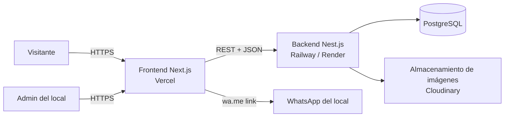

# 02 — Arquitectura

## 1. Vista general



- **Frontend (Next.js):** sitio público y panel de administración (`/admin`). Renderiza páginas con datos del backend.
- **Backend (Nest.js):** API REST, reglas de negocio, autenticación del admin, subida de imágenes.
- **Base de datos (PostgreSQL):** productos, categorías, marcas, servicios, turnos, configuración.
- **WhatsApp:** no hay integración por API; se usan links `https://wa.me/<número>?text=<mensaje>` armados en el frontend.

## 2. Stack

| Capa | Tecnología | Notas |
| --- | --- | --- |
| Frontend | **Next.js 16** (App Router), **TypeScript**, **Tailwind CSS v4** | Ya inicializado en este repo. |
| UI | Componentes propios + Lucide icons | Opcional: shadcn/ui para el panel admin. |
| Formularios | React Hook Form + **Zod** | Validación compartida de esquemas. |
| Estado del carrito | Zustand (persistido en `localStorage`) | El carrito no necesita backend. |
| Backend | **Nest.js**, TypeScript | Módulos por dominio. |
| ORM | **Prisma** | Migraciones versionadas. **[SUPUESTO]** TypeORM es válido si se prefiere. |
| Base de datos | **PostgreSQL** (Neon, Supabase o Railway) | Plan gratuito alcanza para empezar. |
| Autenticación admin | JWT (access + refresh) con Passport, contraseñas con **bcrypt/argon2** | Solo usuarios del local. |
| Imágenes | **Cloudinary** **[SUPUESTO]** | Transformaciones y CDN. Alternativa: Cloudflare R2 o S3. |
| Hosting frontend | **Vercel** | Deploy automático por push. |
| Hosting backend | **Railway** o **Render** **[SUPUESTO]** | Nest.js necesita un servidor siempre activo. |
| Analítica | Vercel Analytics o Google Analytics 4 | Medir clics a WhatsApp. |

## 3. Organización del repositorio

**[DECISIÓN propuesta]** Monorepo con npm workspaces:

```
ciclismo-zonal/
├── apps/
│   ├── web/          # Next.js (lo que hoy está en la raíz)
│   └── api/          # Nest.js
├── packages/
│   └── shared/       # Tipos y esquemas Zod compartidos
├── docs/             # Esta documentación
└── package.json      # Workspaces
```

Ventajas: un solo repo, tipos compartidos entre front y back, un PR puede tocar ambos lados.

> La base actual de Next.js está en la raíz. Moverla a `apps/web` es la primera tarea de la fase 1 (ver `07-roadmap.md`). En Vercel hay que configurar **Root Directory = `apps/web`**.

### Estructura del frontend (`apps/web/src`)

```
app/
├── (sitio)/                # Grupo de rutas públicas (layout con header/footer)
│   ├── page.tsx            # Inicio
│   ├── quienes-somos/
│   ├── catalogo/
│   │   ├── page.tsx
│   │   └── [categoria]/
│   ├── producto/[slug]/
│   ├── carrito/
│   ├── taller/
│   ├── contacto/
│   ├── terminos/
│   └── privacidad/
├── admin/                  # Panel (layout propio, protegido)
├── not-found.tsx
└── layout.tsx              # Fuentes, metadata global
components/
├── ui/                     # Botones, inputs, badges...
├── layout/                 # Header, Footer, MenuMobile
├── catalogo/               # ProductCard, Filtros, Grilla...
└── taller/
lib/
├── api.ts                  # Cliente HTTP al backend
├── whatsapp.ts             # Armado de mensajes y links wa.me
└── format.ts               # Precios, fechas
store/
└── carrito.ts              # Zustand
```

### Estructura del backend (`apps/api/src`)

```
modules/
├── auth/                   # Login, JWT, guards
├── usuarios/
├── productos/
├── categorias/
├── marcas/
├── imagenes/               # Subida a Cloudinary
├── taller/                 # Servicios del taller
├── turnos/                 # Fase 2: agenda y reservas
└── configuracion/          # Datos del local: horarios, WhatsApp, banners
prisma/
├── schema.prisma
└── seed.ts
```

## 4. Estrategia de renderizado (Next.js)

| Página | Estrategia | Por qué |
| --- | --- | --- |
| Inicio, Quiénes somos, Taller, Contacto | Estática con revalidación (ISR, p. ej. cada 1 h) o revalidación on-demand | Cambian poco; carga instantánea y buen SEO. |
| Catálogo y ficha de producto | ISR + **revalidación on-demand** cuando el admin edita un producto | Precios y stock al día sin sacrificar velocidad. |
| Carrito | Client Component | Vive en el navegador. |
| Panel admin | Dinámico, Client Components, sin indexar | Datos privados y en tiempo real. |

El backend llama a un endpoint de revalidación del frontend (`/api/revalidate`, protegido con un secreto) cada vez que se crea o edita un producto, servicio o configuración.

## 5. Entornos y variables

| Entorno | Frontend | Backend | Base de datos |
| --- | --- | --- | --- |
| Local | `localhost:3000` | `localhost:4000` | Postgres en Docker |
| Preview | URL de preview de Vercel por rama | Backend de staging | DB de staging |
| Producción | Dominio del negocio | Backend de producción | DB de producción |

Variables principales:

```bash
# apps/web
NEXT_PUBLIC_API_URL=
NEXT_PUBLIC_WHATSAPP_NUMBER=5492954522411
REVALIDATE_SECRET=

# apps/api
DATABASE_URL=
JWT_SECRET=
JWT_REFRESH_SECRET=
CLOUDINARY_URL=
FRONTEND_URL=          # Para CORS
FRONTEND_REVALIDATE_URL=
REVALIDATE_SECRET=
```

- Nunca se commitean `.env`; se documentan en `.env.example`.

## 6. Seguridad

- CORS restringido al dominio del frontend.
- Rate limiting en login y en endpoints públicos de escritura (`@nestjs/throttler`).
- Validación de toda entrada con `class-validator` (o Zod) en el backend.
- Contraseñas hasheadas; nunca se devuelven en respuestas.
- Subida de imágenes: validar tipo MIME y tamaño (máx. 5 MB).
- Headers de seguridad (Helmet en Nest; `headers()` en `next.config.ts`).
- El panel `/admin` no se indexa (`robots: noindex`) y exige sesión.
- Backups automáticos de la base (los ofrece el proveedor).

## 7. Deploy

1. **Frontend:** Vercel conectado al repo; Root Directory `apps/web`; producción desde `main`, previews por rama.
2. **Backend:** Railway o Render conectado al repo; Root Directory `apps/api`; `prisma migrate deploy` en cada deploy.
3. **Dominio:** apuntar el dominio del negocio a Vercel (y `api.<dominio>` al backend).
