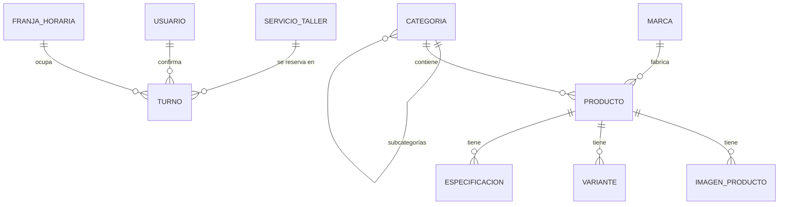

# 03 — Modelo de datos

## 1. Diagrama entidad-relación

## 2. Entidades

### Categoria
| Campo | Tipo | Notas |
| --- | --- | --- |
| id | uuid | PK |
| nombre | string | "Bicicletas", "Mountain Bike" |
| slug | string único | `bicicletas`, `mountain-bike` |
| descripcion | text? | Para SEO y banner |
| imagenUrl | string? | Banner de la categoría |
| padreId | uuid? | FK a Categoria (subcategorías) |
| orden | int | Orden en menús |
| activa | boolean | |

Categorías iniciales (tomadas del sitio actual) **[SUPUESTO, validar]**:

- **Bicicletas**: Mountain Bike, Ruta, Urbana, Infantil, E-bike, BMX
- **Repuestos**: Transmisión, Frenos, Cubiertas y cámaras, Ruedas, Componentes
- **Accesorios**: Luces, Candados, Bolsos y portaequipajes, Soportes para celular, Herramientas, Hidratación
- **Indumentaria**: Cascos, Jerseys, Calzas, Camperas, Guantes, Cubre zapatillas
- **Relojes y electrónica**: Relojes, Ciclocomputadoras

### Marca
| Campo | Tipo | Notas |
| --- | --- | --- |
| id | uuid | PK |
| nombre | string | Scott, Orbea, Shimano, Titan, Leader, Teknial... |
| slug | string único | |
| logoUrl | string? | Para la franja de marcas |
| destacada | boolean | Aparece en Inicio |

### Producto
| Campo | Tipo | Notas |
| --- | --- | --- |
| id | uuid | PK |
| nombre | string | "Scott Aspect 960" |
| slug | string único | Para la URL |
| descripcion | text | Markdown o texto enriquecido |
| precio | decimal(12,2)? | En ARS. **Nulo = "Consultar precio"** |
| precioAnterior | decimal? | Para mostrar descuento |
| stock | enum | `DISPONIBLE`, `POCAS_UNIDADES`, `SIN_STOCK`, `A_PEDIDO` |
| categoriaId | uuid | FK |
| marcaId | uuid? | FK |
| destacado | boolean | Aparece en Inicio |
| nuevo | boolean | Badge "Nuevo" |
| activo | boolean | Oculto si es `false` |
| sku | string? | Código interno |
| creadoEn / actualizadoEn | datetime | |

> **[SUPUESTO]** El stock se maneja como **estado** y no como cantidad exacta: es más fácil de mantener para el local y alcanza para vender por WhatsApp. Si quieren cantidades, se agrega `cantidad: int` a Variante.

### Variante
Para talles, rodados o colores con distinto stock.

| Campo | Tipo | Notas |
| --- | --- | --- |
| id | uuid | PK |
| productoId | uuid | FK |
| nombre | string | "Talle M", "Rodado 29", "Negro / Rojo" |
| tipo | enum | `TALLE`, `RODADO`, `COLOR`, `OTRO` |
| stock | enum | Igual que en Producto |
| precio | decimal? | Si difiere del producto |

### Especificacion
Ficha técnica en pares clave/valor.

| Campo | Tipo | Ejemplo |
| --- | --- | --- |
| id | uuid | |
| productoId | uuid | |
| grupo | string? | "Cuadro", "Transmisión", "Frenos" |
| clave | string | "Material" |
| valor | string | "Aluminio 6061" |
| orden | int | |

### ImagenProducto
| Campo | Tipo | Notas |
| --- | --- | --- |
| id | uuid | |
| productoId | uuid | |
| url | string | Cloudinary |
| alt | string | Texto alternativo (accesibilidad y SEO) |
| orden | int | La primera es la principal |

### ServicioTaller
| Campo | Tipo | Notas |
| --- | --- | --- |
| id | uuid | |
| nombre | string | "Service completo" |
| slug | string único | |
| descripcion | text | Qué incluye |
| incluye | string[] | Lista de tareas |
| precio | decimal? | Nulo = "Consultar" |
| precioDesde | boolean | Mostrar "Desde $..." |
| duracionEstimada | string | "24–48 h", "En el día" |
| duracionMinutos | int? | Para el turnero (fase 2) |
| orden | int | |
| activo | boolean | |

### Turno (fase 2)
| Campo | Tipo | Notas |
| --- | --- | --- |
| id | uuid | |
| servicioId | uuid | FK |
| fecha | date | Día de entrega de la bici |
| franja | enum | `MANANA`, `TARDE` |
| nombre | string | Cliente |
| telefono | string | WhatsApp del cliente |
| email | string? | |
| bicicleta | string | "MTB Scott rodado 29" |
| comentario | text? | Problema o pedido |
| estado | enum | `PENDIENTE`, `CONFIRMADO`, `EN_TALLER`, `LISTO`, `ENTREGADO`, `CANCELADO` |
| codigo | string único | Para que el cliente consulte o cancele |
| confirmadoPorId | uuid? | FK Usuario |
| creadoEn | datetime | |

### FranjaHoraria / CupoTaller (fase 2)
| Campo | Tipo | Notas |
| --- | --- | --- |
| id | uuid | |
| diaSemana | int (1–6) | Lunes a sábado |
| franja | enum | `MANANA`, `TARDE` |
| cupo | int | Bicis que se reciben en esa franja |
| activa | boolean | |

Además, **DiaBloqueado** (`fecha`, `motivo`) para feriados y vacaciones.

### Usuario (admin)
| Campo | Tipo | Notas |
| --- | --- | --- |
| id | uuid | |
| nombre | string | |
| email | string único | |
| passwordHash | string | Nunca se expone |
| rol | enum | `ADMIN`, `EDITOR` |
| activo | boolean | |

### ConfiguracionSitio (registro único)
| Campo | Tipo | Notas |
| --- | --- | --- |
| whatsapp | string | Número en formato internacional |
| telefono | string | |
| email | string | |
| direccion | string | |
| mapsUrl | string | |
| instagram | string | |
| facebook | string | |
| horarios | json | `[{ dias: "Lunes a viernes", turnos: ["8:30–12:30", "16:00–20:00"] }]` |
| avisoSuperior | string? | Barra de anuncio (p. ej. "Envíos a todo el país") |
| heroSlides | json | Imágenes, títulos y links del hero |

## 3. Reglas de negocio

- `slug` se genera a partir del nombre y es único; si cambia el nombre, el slug no cambia salvo que el admin lo edite.
- Un producto con `precio = null` muestra **"Consultar precio"** y el botón principal pasa a "Consultar por WhatsApp".
- Un producto `SIN_STOCK` se muestra pero no puede agregarse al carrito; ofrece "Consultar disponibilidad".
- Borrar categorías o marcas con productos asociados está prohibido: primero hay que reasignar o desactivar.
- Los precios se guardan en pesos con dos decimales y se muestran sin decimales: `$ 1.250.000`.
