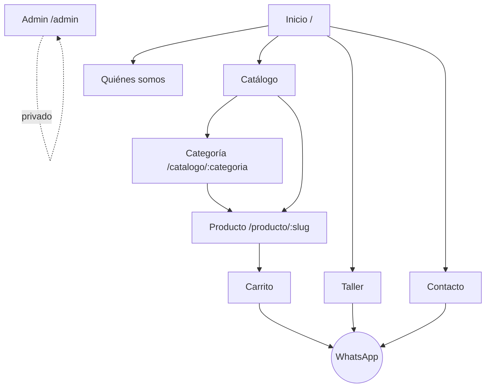

# 05 — Navegación y componentes comunes

## 1. Mapa del sitio

## 2. Header (todas las páginas públicas)

**Barra de aviso** (opcional, editable desde el admin): fondo rojo o grafito, texto corto. Ej.: "Envíos a todo el país · Consultá por WhatsApp".

**Header principal**, fondo negro, sticky al hacer scroll:

| Izquierda | Centro | Derecha |
| --- | --- | --- |
| Logo (imagen, versión clara) | Menú: Inicio · Catálogo ▾ · Taller · Quiénes somos · Contacto | Buscador (ícono) · Carrito (ícono + contador) · Botón WhatsApp |

- **Catálogo ▾** abre un **mega menú** con las categorías principales y sus subcategorías, más una imagen destacada.
- El **buscador** se despliega como overlay con resultados en vivo (nombre, imagen y precio) a partir de 2 caracteres.
- En **mobile**: logo, carrito y menú hamburguesa, que abre un panel lateral a pantalla completa con el menú, las categorías y el WhatsApp.
- El ítem activo se marca con un subrayado rojo.

## 3. Footer

Fondo negro, 4 columnas en desktop y apiladas en mobile:

1. **Marca**: logo, frase corta y redes (Instagram, Facebook).
2. **Tienda**: links a las categorías principales.
3. **Taller**: servicios destacados y link a pedir turno.
4. **Contacto**: dirección (link a Google Maps), WhatsApp, email y horarios.

Barra inferior: "© 2026 Ciclismo Zonal Bike Store · Términos · Privacidad". Opcional: crédito al desarrollo.

## 4. Botón flotante de WhatsApp

- Fijo abajo a la derecha en todas las páginas públicas, salvo en el carrito, donde ya hay CTA.
- Mensaje genérico: "¡Hola Ciclismo Zonal! Quería hacer una consulta."
- En la ficha de producto, el mensaje incluye el producto que se está viendo.

## 5. Componentes reutilizables

| Componente | Uso | Notas |
| --- | --- | --- |
| `Button` | Variantes: `primario` (rojo), `secundario` (borde), `whatsapp`, `ghost` | Tamaños sm, md, lg |
| `SectionTitle` | Eyebrow + título H2 + bajada | Coherencia entre secciones |
| `ProductCard` | Imagen, marca, nombre, precio, badges, botón "Agregar" | Estados: sin stock, consultar precio, oferta |
| `ProductGrid` | Grilla responsive 2/3/4 columnas | Con skeletons de carga |
| `Badge` | "Nuevo", "Oferta -15 %", "Sin stock", "Últimas unidades" | |
| `Price` | Formatea ARS; muestra el precio anterior tachado | `Intl.NumberFormat('es-AR')` |
| `CategoryCard` | Imagen a sangre con overlay y nombre | Para Inicio |
| `BrandStrip` | Franja de logos de marcas | Logos en blanco y negro, color al hover |
| `Breadcrumbs` | Inicio / Catálogo / MTB / Producto | También genera datos estructurados |
| `WhatsAppButton` | Recibe el mensaje y arma el link `wa.me` | Abre en pestaña nueva |
| `HorariosLocal` | Muestra horarios y "Abierto ahora / Cerrado" | Hora de Argentina (UTC-3) |
| `MapaLocal` | Embed de Google Maps con lazy load | |
| `EmptyState` | Sin resultados, carrito vacío | Con acción sugerida |
| `Toast` | "Producto agregado al carrito" | |

## 6. Responsive

| Breakpoint | Ancho | Grilla de productos |
| --- | --- | --- |
| Mobile | < 640 px | 2 columnas |
| Tablet | 640–1024 px | 3 columnas |
| Desktop | > 1024 px | 4 columnas, contenedor máx. 1280 px |

Diseño **mobile first**: la mayoría del tráfico va a llegar desde Instagram, en el celular.
