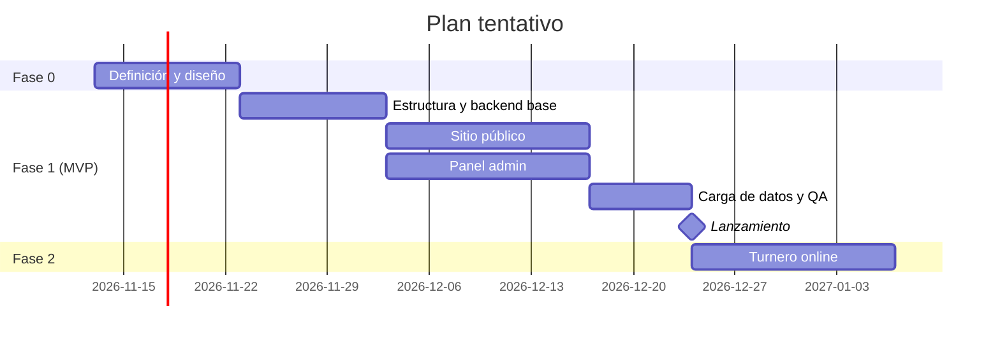

# 07 — Roadmap

Plan por fases. Cada ítem se trabaja en una **rama propia con Pull Request** y se revisa en la **URL de preview de Vercel** antes de pasar a `main`.

> Las fechas son orientativas; dependen de la disponibilidad y de los tiempos de respuesta del negocio.

## Fase 0 — Definición y diseño
- [x] Base del proyecto Next.js en el repo.
- [x] Documentación inicial (esta carpeta).
- [ ] Validar con el negocio la lista de `08-pendientes-a-confirmar.md`.
- [ ] Conseguir el logo en alta calidad y las fotos (local, taller, productos).
- [ ] **Boceto visual** de Inicio, Catálogo y Ficha (artifact o Figma) y aprobación del estilo.

## Fase 1 — MVP (lanzamiento)

### 1.a Estructura y backend base
- [ ] Reorganizar en monorepo: `apps/web` (Next.js), `apps/api` (Nest.js), `packages/shared`.
- [ ] Reemplazar el contenido de ejemplo actual (calendario, resultados) por la estructura de la bicicletería.
- [ ] Nest.js + Prisma + PostgreSQL: módulos de productos, categorías, marcas, servicios, configuración y auth.
- [ ] Seed con categorías, marcas y algunos productos de prueba.
- [ ] Deploy del backend (Railway o Render) y de la base de datos.
- [ ] CI en GitHub Actions.

### 1.b Sitio público
- [ ] Tokens de diseño (colores, fuentes) y componentes base.
- [ ] Header, footer, menú mobile y botón flotante de WhatsApp.
- [ ] Inicio.
- [ ] Catálogo con filtros, orden, búsqueda y paginación.
- [ ] Ficha de producto.
- [ ] Carrito y pedido por WhatsApp.
- [ ] Taller con servicios y turno por WhatsApp.
- [ ] Quiénes somos, Contacto, Términos, Privacidad y 404.
- [ ] SEO: metadata, sitemap, robots y JSON-LD.

### 1.c Panel de administración
- [ ] Login y roles.
- [ ] Productos (CRUD, imágenes, variantes, especificaciones, edición en línea).
- [ ] Actualización masiva de precios.
- [ ] Categorías, marcas, servicios del taller y configuración.
- [ ] Revalidación del sitio al guardar.

### 1.d Carga y lanzamiento
- [ ] Carga del catálogo real (con el negocio o por importación CSV).
- [ ] QA en mobile y desktop, Lighthouse y accesibilidad.
- [ ] Capacitación corta al personal sobre el panel (y una guía de uso en `docs/`).
- [ ] Dominio, Google Business Profile y redirecciones del sitio anterior.
- [ ] 🚀 Lanzamiento.

## Fase 2 — Mejoras
- [ ] **Turnero online** con agenda, cupos y estados (ver `paginas/taller.md`).
- [ ] Importación de productos por CSV/Excel.
- [ ] Guía de talles y FAQ del taller.
- [ ] Grilla de Instagram en Inicio.
- [ ] Formulario de contacto con guardado en el backend.

## Fase 3 — Futuro (a evaluar)
- [ ] Pago online con **Mercado Pago** y gestión de pedidos.
- [ ] Cotización automática de envíos (Correo Argentino o Andreani).
- [ ] Notificaciones automáticas por WhatsApp Business API.
- [ ] Blog o sección de salidas y eventos.
- [ ] Cuentas de clientes e historial de services de su bici.
